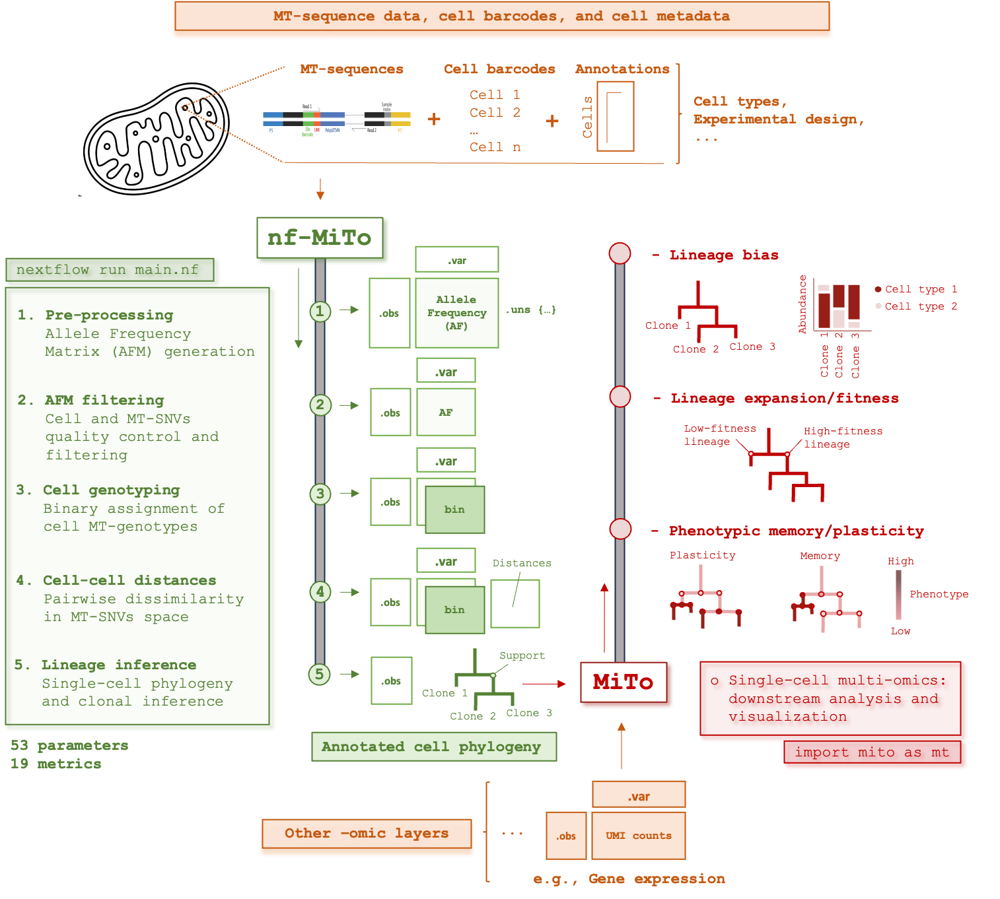

<div align="center">



<div style="background: linear-gradient(135deg, #1e3c72 0%, #2a5298 50%, #6a85b6 100%); padding: 60px 40px; border-radius: 25px; margin: 30px auto; max-width: 1000px; box-shadow: 0 20px 50px rgba(0,0,0,0.3); border: 4px solid rgba(255,255,255,0.15);">
  
  <h1 style="border: none; font-family: 'SF Mono', 'Monaco', 'Inconsolata', 'Roboto Mono', 'Source Code Pro', 'Menlo', 'Consolas', monospace; font-size: 6em; font-weight: 900; margin: 20px 0; letter-spacing: 0.05em; text-transform: none; line-height: 1;">
    <span style="background: linear-gradient(45deg, #ff6b6b, #ff8e53, #ff6b9d); -webkit-background-clip: text; -webkit-text-fill-color: transparent; background-clip: text; filter: drop-shadow(3px 3px 6px rgba(0,0,0,0.4));">nf</span><span style="color: #ffffff; margin: 0 0.08em; filter: drop-shadow(2px 2px 4px rgba(0,0,0,0.6));">-</span><span style="background: linear-gradient(45deg, #4ecdc4, #44a08d, #093637); -webkit-background-clip: text; -webkit-text-fill-color: transparent; background-clip: text; filter: drop-shadow(3px 3px 6px rgba(0,0,0,0.4));">MiTo</span>
  </h1>
  
  <div style="width: 200px; height: 6px; background: linear-gradient(90deg, #ff6b6b, #ff8e53, #4ecdc4, #44a08d); margin: 35px auto; border-radius: 3px; box-shadow: 0 3px 12px rgba(0,0,0,0.4);"></div>
  
  <p style="font-size: 1.5em; font-weight: 400; color: #f8f9fa; margin: 30px 0 10px 0; line-height: 1.6; font-style: italic; text-shadow: 2px 2px 4px rgba(0,0,0,0.4); max-width: 800px; margin-left: auto; margin-right: auto;">
    Mitochondrial lineage tracing and single-cell multi-omics (Nextflow)
  </p>
  
</div>

[](https://www.nextflow.io/)
[](https://www.docker.com/)
[](https://opensource.org/licenses/MIT)
[](https://doi.org/10.1101/2025.06.17.660165)

</div>

## Overview

nf-MiTo 2.0.0 is a Nextflow pipeline for the **preprocessing** of mitochondrial single-cell lineage tracing (MT-scLT) data. From sequencing reads (FASTQ) or an aligned BAM of the library holding the mitochondrial reads, it produces the single-cell allele tables read by [MiTo](https://github.com/andrecossa5/MiTo) (`mt.io.make_afm`). Filtering, genotyping, trees and clones are done in MiTo, not here.

It packages three tools, one per assay:

| `--assay` | Library | Tool (`pp_method` in MiTo) | Alignment | Tables |
|---|---|---|---|---|
| `MAESTER` | 10x GEX + MAESTER MT amplicons | [maegatk](https://github.com/petervangalen/MAESTER-2021) (`maegatk`) | STARsolo | `A,C,G,T,coverage,depth.txt.gz` |
| `mtscATAC` | 10x scATAC | [mgatk](https://github.com/caleblareau/mgatk) (`mgatk`), `bcall` mode | bwa-mem2 | `A,C,G,T,coverage,depth.txt.gz`, `refAllele.txt` |
| `ReDeeM` | 10x Multiome ATAC, ReDeeM protocol | [RedeemV](https://github.com/chenweng1991/redeemV) (`redeem-v`) | bwa-mem2 | `RawGenotypes.<level>.StrandBalance.gz`, `QualifiedTotalCts.gz` |

Every assay follows the same two stages, starting from the library holding the MT reads:

1. **Reads → MT BAM** (skipped if you give a BAM): one library-level, coordinate-sorted BAM of chrM reads with the cell barcode in a tag (`--barcode_tag`, default `CB`).
2. **MT BAM → single-cell tables**: the BAM is split in chunks of cell barcodes (`--CBs_chunk_size`) and filtered with Picard `FilterSamReads`, then processed by the assay's tool (per cell for maegatk and mgatk, per chunk for RedeemV) and collapsed into the tables.

For `mtscATAC` and `ReDeeM`, reads are aligned with bwa-mem2 to the GRCh38 genome with the nuclear mitochondrial insertions (NUMTs) masked.

nf-MiTo 2.0.0 does not use the MiTo package; there is no MiTo image. See [MiTo: tracing the phenotypic evolution of somatic cell lineages via mitochondrial single-cell multi-omics](https://doi.org/10.1101/2025.06.17.660165) for the method.

## Quick start

### Prerequisites

- [Nextflow](https://www.nextflow.io/) ≥ 24.04.0
- Docker, Singularity/Apptainer, or Conda (see [Software](#software)).
- `mtscATAC` and `ReDeeM` use bwa-mem2, which is x86_64 only.

### Samplesheet

`--input` is a CSV with one row per library:

```csv
sample,fastq_dir,bam,cell_barcodes
s1,/data/s1_fastq,,/data/s1_cells.txt
s2,,/data/s2_MT.bam,/data/s2_cells.txt
```

| Column | Description |
|---|---|
| `sample` | Unique sample name. |
| `fastq_dir` | Folder with the library's FASTQ files. Give **either** this or `bam`. MAESTER: `*R1*.fastq.gz` and `*R2*.fastq.gz`. mtscATAC/ReDeeM: cellranger-atac names `*_R1_*`, `*_R2_*` (16-nt barcode read), `*_R3_*`; lanes are concatenated in order. |
| `bam` | Coordinate-sorted, indexed BAM of the MT reads, with the cell barcode in the `--barcode_tag` tag (and `UB` for MAESTER). For ReDeeM it must come from an alignment to a NUMT-masked genome. |
| `cell_barcodes` | Required. One barcode per line, in the form found in the BAM tag. For reads, the barcode is matched with up to 1 mismatch; reads of other barcodes are dropped. With `--barcode_space RNA`, the list is in the RNA space (Cell Ranger ARC `barcodes.tsv`) and is converted to ATAC barcodes with the 10x Multiome whitelist pair. |

### Run

```bash
nextflow run andrecossa5/nf-MiTo -r v2.0.0 -profile singularity \
  --assay mtscATAC --input samplesheet.csv --output_folder results \
  --reference_genome <GRCh38.fa(.gz)> --NUMTs_regions <NUMTs.bed>
```

Use `-c <user.config>` for site settings (see [`config/user.config`](config/user.config)) and `-params-file <params.json>` for parameters. `-profile` is `docker`, `singularity` or `conda`; add `local` or a custom executor profile as needed. `nextflow run . --help` lists the parameters.

### Output

```
<output_folder>/
├── resources/                # reference index, whitelists (reusable)
└── <sample>/MT.preprocess.ouput/    # the tables for this sample
```

Load them in MiTo (here for ReDeeM):

```python
import mito as mt
afm = mt.io.make_afm(path_to_tables, 'ReDeeM', 'redeem-v')   # or ('MAESTER', 'maegatk'), ('mtscATAC', 'mgatk')
```

## Assay notes

- **MAESTER**: STARsolo on the GEX+MAESTER reads (`--tenx_whitelist`, `--gtf`; the STAR index is built once, or passed with `--prebuilt_STAR_index`, see [`docs/create_STAR_index.md`](docs/create_STAR_index.md)), MT reads kept with `--string_MT`, then UMI consensus (fgbio) and maegatk counting per cell.
- **mtscATAC**: the barcode is read from the 16-nt barcode read (`--atac_barcode_rule auto` detects forward or reverse-complement), reads are aligned with bwa-mem2 and the MT pairs (`--atac_min_mapq`) are kept. mgatk runs in `bcall` mode on one BAM per cell, with the `--mgatk_*` filters.
- **ReDeeM**: same alignment as mtscATAC. RedeemV's `mitoConsensus.py` (shipped in `bin/`, unmodified, from RedeemV commit `5c34940`) builds molecule consensus genotypes at four stringency levels (`Total`, `VerySensitive`, `Sensitive`, `Specific`). A **strand-bias filter** then runs per variant, pooled over all cells of the library: a two-sided binomial test of the plus/minus molecule counts against 0.5, converted to Storey q-values (`--redeem_strand_bias_correction storey`, as in RedeemV) or used as raw p-values (`none`). A variant is blacklisted if the p/q-value is below `--redeem_strand_bias_p` and the strands differ by more than `--redeem_strand_bias_log2fc`; its rows are removed unless they have duplex support. Every tested variant is listed in `StrandBiasTable.tsv.gz`.

## Parameters

Defaults are in `nextflow.config` and typed in `nextflow_schema.json`.

| Group | Parameters |
|---|---|
| Input/output | `--input`, `--assay` (`MAESTER`, `mtscATAC`, `ReDeeM`), `--output_folder`, `--barcode_tag` (`CB`) |
| Reference | `--reference_genome`, `--NUMTs_regions`, `--string_MT` (`chrM`); MAESTER: `--gtf`, `--tenx_whitelist`, `--build_STAR_index`, `--prebuilt_STAR_index` |
| Chunking | `--CBs_chunk_size` (3000 barcodes) |
| mtscATAC/ReDeeM reads | `--atac_min_mapq` (30), `--atac_barcode_rule` (`auto`), `--barcode_space` (`ATAC` or `RNA`), `--multiome_whitelist_rna`, `--multiome_whitelist_atac` |
| mgatk | `--mgatk_keep_duplicates`, `--mgatk_handle_overlap`, `--mgatk_proper_paired`, `--mgatk_umi_tag`, `--mgatk_base_qual`, `--mgatk_alignment_quality`, `--mgatk_NHmax`, `--mgatk_NMmax` |
| RedeemV | `--redeem_base_quality` (30), `--redeem_strand_bias_correction` (`storey`), `--redeem_strand_bias_p` (0.01), `--redeem_strand_bias_log2fc` (1) |

## Software

One image per tool, built from [`envs/`](envs) (also the recipes of the conda profile):

| Label | Image | Used for |
|---|---|---|
| `maegatk` | `acox1/mito-maegatk:2.0.0` | MAESTER, reference preparation, barcode chunking and Picard filtering |
| `mgatk` | `acox1/mito-mgatk:2.0.0` | bwa-mem2 alignment, mgatk (v0.9.0) |
| `redeemv` | `acox1/mito-redeemv:2.0.0` | RedeemV consensus and strand-bias filter |

Build with `docker build --platform linux/x86_64 -f docker/Dockerfile_<tool> -t acox1/mito-<tool>:2.0.0 .` from the repository root. Scripts are in [`bin/`](bin) and are on the `PATH` of every task.

## Versions

| nf-MiTo | MiTo | Notes |
|---|---|---|
| `v1.0.0` | `scmito>=1.0.2,<2` (original API), container `acox1/mito:1.0.2` | Pipeline of the paper (preprocessing, tuning, inference). Analyses in [MiTo_benchmark_repro](https://github.com/andrecossa5/MiTo_benchmark_repro). |
| `v2.0.0` (in development) | `>=2.0.0` | Preprocessing only, three assays; tables are loaded with `mt.io.make_afm`. TUNE, EXPLORE, INFER and BENCH were removed. |

## Troubleshooting

1. **Memory errors**: resources are set per process in `config/base.config`; override them in your `-c` config. `BWAMEM2_MT` and `BWAMEM2_INDEX` request 40 GB.
2. **Samplesheet errors**: the pipeline checks the CSV at launch and names the row and column.
3. **Barcodes not found**: `cell_barcodes` must match the BAM tag (or the reads, for FASTQ input); use `--barcode_space RNA` for Cell Ranger ARC lists.

Issues: GitHub Issues.

## Citation

If you use nf-MiTo in your research, please cite:

*MiTo: tracing the phenotypic evolution of somatic cell lineages via mitochondrial single-cell multi-omics. Andrea Cossa, Alberto Dalmasso, Guido Campani, Elisa Bugani, Chiara Caprioli, Noemi Bulla, Andrea Tirelli, Yinxiu Zhan, Pier Giuseppe Pelicci. biorxiv. doi:https://doi.org/10.1101/2025.06.17.660165*

and the tool you used: maegatk/MAESTER (Miller et al., Nat. Biotechnol. 2022), mgatk (Lareau et al., Nat. Biotechnol. 2021), RedeemV/ReDeeM (Weng et al., Nature 2024).

## License

MIT, see [LICENSE](LICENSE). `bin/mitoConsensus.py` is RedeemV code (chenweng1991/redeemV, commit `5c34940`) and is not covered by this licence.
