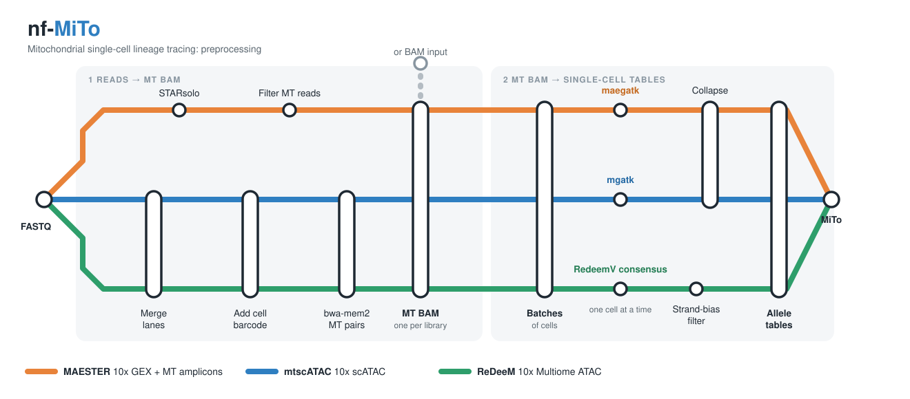

<div align="center">



[](https://www.nextflow.io/)
[](https://nf-mito.readthedocs.io)
[](https://opensource.org/licenses/MIT)
[](https://doi.org/10.1101/2025.06.17.660165)

</div>

nf-MiTo is a [Nextflow](https://www.nextflow.io/) pipeline that turns mitochondrial single-cell lineage tracing data (`MAESTER`, `mtscATAC`, `ReDeeM`) into the single-cell allele tables read by [MiTo](https://github.com/andrecossa5/MiTo).

## Usage

Make a samplesheet (one library per run) and a NUMT-masked genome FASTA:

```csv
sample,fastq_dir,bam,cell_barcodes
donorX,/data/donorX_fastq,,/data/donorX_cells.txt
```

Give either `fastq_dir` or `bam`. `cell_barcodes` is a text file with one barcode per line.

```bash
nextflow run andrecossa5/nf-MiTo -r v2.0.0 -profile singularity \
  --assay mtscATAC \
  --input samplesheet.csv \
  --masked_ref masked.fa \
  --output_folder results/donorX
```

The tables are written in `results/donorX`. Load them in MiTo:

```python
import mito as mt
afm = mt.io.make_afm('results/donorX', 'mtscATAC', 'mgatk')   # or ('MAESTER', 'maegatk'), ('ReDeeM', 'redeem-v')
```

## Documentation

Installation, a quickstart for each assay, how to make the masked reference and all the parameters are in the [documentation](https://nf-mito.readthedocs.io) (sources in [`docs/`](docs)).

## Citation

*MiTo: tracing the phenotypic evolution of somatic cell lineages via mitochondrial single-cell multi-omics.* Cossa A, Dalmasso A, Campani G, Bugani E, Caprioli C, Bulla N, Tirelli A, Zhan Y, Pelicci PG. bioRxiv. [doi:10.1101/2025.06.17.660165](https://doi.org/10.1101/2025.06.17.660165)

MIT license.
